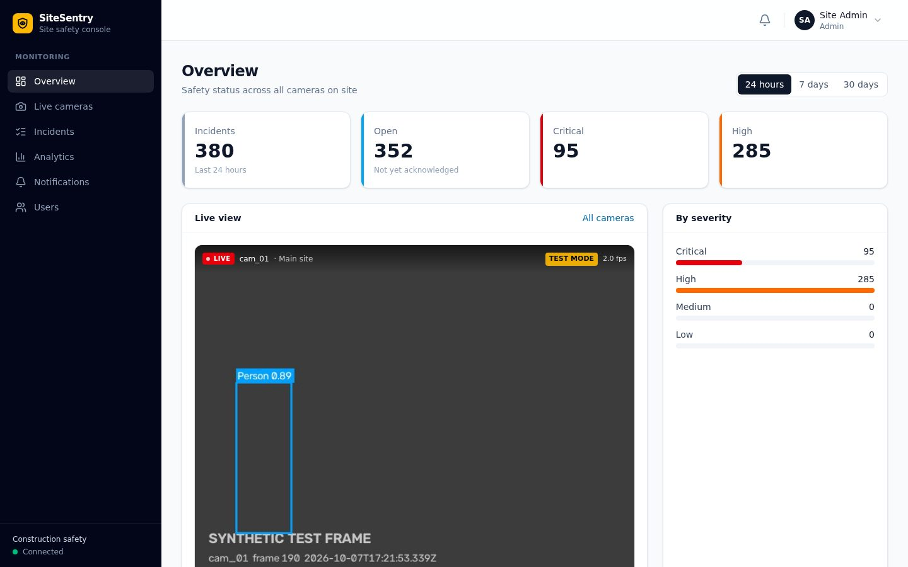

# SiteSentry

**A camera watches a construction site. When someone breaks a safety rule, the supervisor gets an alert with a
photo, a short video clip, a written report and the regulation clause that was broken, within seconds.**
Everything that sees and decides runs on a small NVIDIA Jetson on site, so video never leaves the site.

Product page: **https://edge-ai-safety.pages.dev** (with a live demo link when the site camera is on)



Graduation project, Misr University for Science & Technology (five-year programme), 2026.

## What it does

- **Personal protective equipment:** hard hat and high-visibility vest, per person, optionally only inside a zone.
- **Zones:** no-entry areas, loitering under a crane, too many people on a scaffold level. Zones are drawn on
  the live picture in the console.
- **Machinery:** a worker too close to moving machinery (distance scaled to the person's size in the picture).
- **Smoking:** each person's head and upper body is classified as smoking, holding a cigarette or neither, so a
  cigarette in the hand is not an alarm.
- **Face recognition (optional):** names the people the site has enrolled; everyone else is "unknown".
- **For every incident:** a snapshot, an ~8 s clip, a report in English and Arabic (written by Claude or Gemini
  from the recorded facts only, or by a template), the clause of the official code of practice that applies, and
  an email to the supervisor. Repeats are grouped; an email that can't be sent is retried for up to a day.
- **Console:** live cameras, incidents with one-tap handling, analytics, rules that can be switched on and off or
  limited to working hours without a restart, zones, people and users. English and Arabic, phone and desk.

## Measured results

| What | Result | Where measured |
|---|---|---|
| PPE model (YOLO11s, 960 px), held-out test set | mAP50 0.848 (TensorRT FP16 on the Jetson: 0.843) | 82 test images, `jetson/README.md` |
| Live detection on the Jetson Orin Nano | 28–32 frames a second (camera: 30), 25 W mode, no throttling | `jetson/README.md` |
| Smoking-act classifier, held-out test set | 88.5% of smokers found, 98% of "smoking" answers right, 0.6% false alarms, 0% of construction workers flagged | `docs/team_notes.md` |
| Face recognition (LFW) | over 99% named right, no stranger named, down to 28 px faces | `docs/faces.md` |
| Live view in the console over the internet | about 20 pictures a second, under 0.1 s behind the camera, no stalls | `docs/cameras.md` |
| Report citations | 10 of 11 construction rules quote their code-of-practice clause word for word | `docs/regulations.md` |

The test sets are small and were made by the team, so these are checks of this system, not benchmark claims.

## How it works

```
USB camera ──> cv_pipeline (Jetson GPU: YOLO + TensorRT, smoking classifier, face recognition)
                  │  detections (Redis stream)          │ latest picture, clips, snapshots
                  v                                     v
              event_engine (rules: zones, durations,   backend (FastAPI + PostgreSQL) <──> console (React)
              distances, working hours) ──incidents──>    ^
                                                          │ reports
              ai_reporting (report EN/AR, regulation clause, email) <──┘
```

A second plugin, `plugins/hospital_safety.json` (masks and gowns in an isolation room, a medication store,
room capacity, smoking), runs on the same code with its own model: `docs/plugins.md`.

One plugin file per domain (`plugins/construction_safety.json`) says which classes the models look for, which
rules apply, the zones, the recommended actions, the regulation clauses and the Arabic text. Message formats
between services: `docs/contracts.md`.

| Folder | What |
|---|---|
| `cv_pipeline/` | Camera, detection, face recognition, live view, clips and snapshots |
| `event_engine/` | Turns detections into incidents according to the plugin's rules |
| `backend/` | API, sign-in, incidents, rules, zones, cameras, people |
| `ai_reporting/` | Reports, regulation citations, alert and daily summary emails |
| `frontend/` | Console and product page |
| `plugins/` | Domain definitions (construction) |
| `training/` | Dataset checks and model training scripts |
| `jetson/` | Jetson setup, TensorRT, benchmark, hardening |

## Run it

On a laptop (simulated detections, no camera needed):

```bash
cp .env.example .env            # then set AUTH_SECRET, INTERNAL_API_TOKEN and an admin password
docker compose up -d --build    # console at http://localhost:3000
```

On the Jetson with the real camera: `jetson/README.md`. Going public: `docs/deploy.md`. Several cameras:
`docs/cameras.md`. Face recognition: `docs/faces.md`. All checks before a demo: `scripts/check-all.sh`.

## Companion project

[SiteSentry Regs](https://github.com/albaraafarag23/sitesentry-regs) answers questions about construction-safety
regulations with cited clauses (Arabic and English). SiteSentry's reports quote the clauses it found for each rule.

## Team

Albaraa Waheed Farag (team lead), Youssef Hazem Mohammed, Youssef Mohammed Nofal, Omar Ahmed Abdelnabi,
Abdullah Mohammed Attia, Ebtsam Mohamed Hassan, Hassan Salah Eldien Hassan.
Supervisor: Dr. Mahmoud Sayed Kamel Hassan.

## Licences of what we build on

The face recognition model (InsightFace ArcFace, `buffalo_l`) and the Stanford 40 Actions images used in
training are for non-commercial research only: fine for this project, to be replaced or licensed before any
commercial use. The CigDet dataset is CC BY 4.0. Regulation texts are the Sharjah Prevention and Safety
Authority's codes of practice, quoted with their source.
